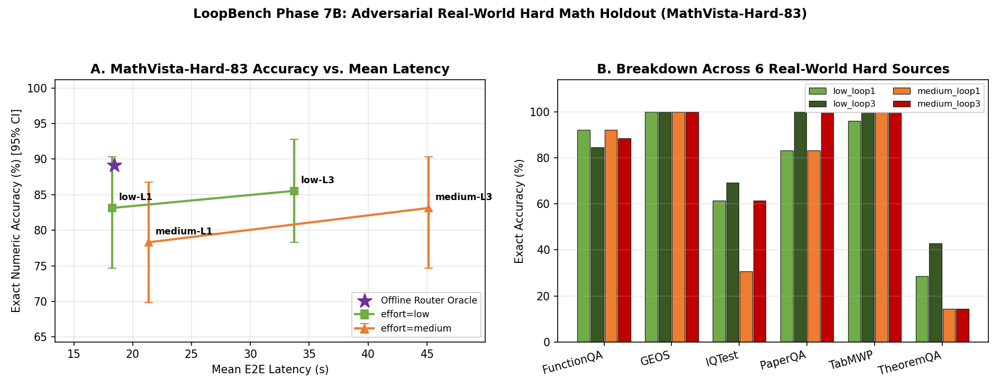

# LoopBench

**Measuring Accuracy–Latency–Memory Trade-offs of Latent Looping and Explicit Reasoning in Multimodal Inference.**

LoopBench is a reproducible multimodal inference benchmark and evaluation harness built around `thinkingmachines/TML-d24-varloop-research` (`c90921bd5f78df6c8168173b9f8a3a850320c594`) on NVIDIA RTX PRO 6000 Blackwell Server Edition (96 GB). Across **Phases 1–7** (`2,655` real GPU evaluations + `120`-image independent blind multimodal QA + strict out-of-fold online routing + Blackwell CUDA-event GPU systems profiling), it isolates the causal effects of **latent pass depth** (`loop_num_passes ∈ {1, 2, 3, 5}` → `24 / 36 / 48 / 72` verified effective layers) and **explicit reasoning effort** (`none / low / medium / high`) across synthetic charts, Euclidean geometry, real-world `ChartQA-80`, and adversarial hard real-world math (`MathVista-Hard-83`).

---

## Executive Results Summary (Phases 1–7 Completed)

| Phase | Scope & Dataset | Key Result | Report |
| :---: | --- | --- | --- |
| **1** | Deterministic CPU/mock pipeline, 12-template generator, crash-resilient JSONL storage, 5-way error taxonomy, cluster bootstrap CI | Schema v2 locked; 100% deterministic mock/unit suite | [FINAL_PLAN.md](docs/FINAL_PLAN.md) |
| **2** | Colab G4 Blackwell verification, causal `loop=1` vs `loop=3` hook check, Serving Backend Gate & 12-Q decoding diagnostic | Verified in-place zero-reload `24L → 48L` switching (`loads=1`), locked `Transformers` reference backend & `temperature=0.0` | [phase2_g4_probe.md](reports/phase2_g4_probe.md) |
| **3** | `smoke-48` pass curve (`loop ∈ {1,2,3,5}`, `192` evals) + `blank` / `mismatched` visual leakage gate (`96` evals) | Visual grounding gate passed (`97.9%` correct vs `0.0%` blank / `2.1%` mismatched); `VRAM +0.34%` across `3×` depth | [phase3_smoke48.md](reports/phase3_smoke48.md) |
| **4** | Main synthetic suite `synth-240` (`120` images × `2` Qs, `24` `v1+v2` templates, `960` GPU evals, `effort="medium"`) + blind `Gemini 4 Argon` QA (`120/120` clear, `97.5%`) | `93.75% → 95.42%` (`loop=1→5`, `3.62×` P50 latency); wrong answers halved (`10 → 5`); CoT compressed `-10.9%`; `VRAM +0.48%` (`+243 MB`); `trigger_synth320=false` | [phase4_synth240.md](reports/phase4_synth240.md), [argon_multimodal_audit.md](reports/argon_multimodal_audit.md) |
| **5** | **5A**: `4×3` Explicit Effort × Latent Pass matrix (`effort48`, `576` evals). **5B**: Real-world `ChartQA-80` holdout (`320` evals) | **5A**: **`low + loop=3` hits `97.9%` (`47/48`, `0` wrong)** with significant **`+8.33%` `[+2.08%, +16.67%]`** gain over both `low+loop=1` & `none+loop=3` while cutting P50 latency `-26.7%`. **5B**: `ChartQA-80` saturates at `loop=1` (`90.0%` relaxed / `92.5%` pct-norm, `3.89×` faster than `loop=5`) | [phase5_effort_holdout.md](reports/phase5_effort_holdout.md) |
| **6** | Offline Router & Cascade Oracles across Phase 4 & 5 traces + Cross-Pass CoT Failure/Repair Audit | `synth-240` Router Oracle reaches **`98.75%` (`+3.33%` `[+1.25%, +5.83%]`)** at **`3.38×` speedup** (`70.4%` GPU-s saved); `effort48` Router reaches **`2.09×`** speedup; exposes 3 CoT flip mechanisms (target-swap repair, pixel-ruler over-calibration, high-effort truncation) | [phase6_oracle_systems.md](reports/phase6_oracle_systems.md) |
| **7A** | Strict anti-leakage Out-of-Fold Online Routing (`image_id` 5-Fold, LOTO `k=24`, Zero-Shot transfer across `1,856` traces) | Exposes Oracle Gap: post-pass-1 CoT cascades fail on `synth-240` (`93.3%–94.6%`); `PreGen Ridge` hits `96.25% @ 2.24×` speedup in-domain but weight audit reveals reliance on synthetic prompt structure | [phase7a_online_routing.md](reports/phase7a_online_routing.md) |
| **7B / 7C** | **7B**: Adversarial real-world `MathVista-Hard-83` (`2×2` grid `332` evals + `83` blank-image control). **7C**: Blackwell CUDA-Event breakdown, `bs ∈ {1,2,4,8}` scaling & KV cache ablation | **7B**: `low_loop3` (`85.54%`, trunc `7→1`, CoT `-25.4%`) Pareto-dominates `medium` (`78.31%/83.13%`), though `+2.41%` vs `low_loop1` (`83.13%`) is non-significant; blank control = `6.02%` (`+77.11 pp` visual gain); routing flips vs synthetic (`HardFail` cascade wins, OOF `PreGen` drops to `80.7%`). **7C**: `DynamicCache` grows exactly `+48 KB/tok/pass`; `bs=1→8` scales decode `5.07×–5.76×` (`151.1 / 71.1 tok/s`) within `51.8 GB` VRAM | [phase7b_mathvista_and_7c_systems.md](reports/phase7b_mathvista_and_7c_systems.md) |

> Mock outputs under `artifacts/mock/` are synthetic test fixtures, not model measurements. Compact real GPU evaluation summaries and figures live under `artifacts/phase{2,3,4,5,6,7,7b_mathvista,7c_gpu_systems}/`, while full bulky raw JSONL traces and logs are archived cloud-first to `mydrive:inkling_loop_bench/phase{3,4,5,6,7b,7b_blank,7c}` via `rclone`.

---

## Setup & Verification

~~~bash
git clone https://github.com/XDE10/inkling-loop-bench.git
cd inkling-loop-bench
python -m pip install -e ".[dev]"

# Run local mock pipeline & full unit test suite (Phases 1-6)
python scripts/run_mock.py --config configs/mock.yaml
PYTHONPATH=src python -m pytest -q
~~~

## Reproducing GPU & Offline Analysis Suites

~~~bash
# Phase 2 & 3 (Colab G4 Blackwell)
python scripts/run_phase2_colab_suite.py --config configs/smoke.yaml --out artifacts/phase2
python scripts/run_phase3_smoke48.py --config configs/smoke.yaml --out artifacts/phase3

# Phase 4 (synth-240 main pass-depth study)
python scripts/run_phase4_synth240.py --config configs/synth240.yaml --out artifacts/phase4

# Phase 5 (effort48 4x3 matrix + ChartQA-80 real-world holdout)
python scripts/run_phase5_suite.py \
  --effort-config configs/phase5_effort.yaml \
  --holdout-config configs/phase5_holdout.yaml \
  --out artifacts/phase5

# Phase 6 (Offline Router/Cascade Oracles + cached cross-pass CoT audit)
python scripts/run_phase6_ablations.py --phase4-dir <p4_jsonls> --phase5-dir <p5_jsonls> --out artifacts/phase6
python scripts/run_gemini_crosspass_audit.py --phase4-dir <p4_jsonls> --phase5-dir <p5_jsonls> --out artifacts/phase6/gemini_crosspass_audit.json

# Phase 7 (Anti-leakage OOF online routing + MathVista-Hard-83 + Blackwell GPU systems microbenchmarks)
python scripts/run_phase7_online_router.py --phase4-dir <p4_jsonls> --phase5-dir <p5_jsonls> --out artifacts/phase7
python scripts/run_phase7_mathvista.py --config configs/phase7_mathvista.yaml --out artifacts/phase7b_mathvista --efforts low,medium --passes 1,3
python scripts/run_phase7_gpu_systems.py --config configs/phase7_mathvista.yaml --image <sample_png> --out artifacts/phase7c_gpu_systems
~~~

## Key Visual Summary

## Scope & Methodological Limitations

- **Reference Backend (`batch_size=1`) vs. Production Serving**: Main accuracy–latency sweeps use the official HuggingFace `Transformers` BF16 reference backend (`concurrency=1`, `loop_share_cache=False`, no NVFP4/PagedAttention/DSpark speculation). Phase 7C proves `bs=1` is strongly memory-bandwidth-bound (~1/5 hardware throughput): raising `batch_size` to `4–8` scales aggregate decode `3.87×–5.76×` (`151.1 / 71.1 tok/s` for `loop=1 / 3`) within `51.8 / 96 GB` VRAM, while unshared HF `DynamicCache` adds `+48 KB/tok` per pass.
- **Synthetic Ceiling & Confound Disclosure**: In Phase 4 (`synth-240`, `effort="medium"`), synthetic charts saturate near `99–100%` at `loop=1`, so global `loop5 − loop1` (`+1.67%`) is not statistically significant (`95% CI [-1.67%, +5.42%]`). In Phase 5A (`effort48`, `n=48`), the statistically significant `+8.33%` gain of `low+loop=3` over `low+loop=1` reflects `4/48` repaired `geometry/direct` items where the paired multi-step red `?` marker induced target-swap errors at `loop=1`—an important benchmark-design caveat.
- **Real-World Holdout Boundaries (`ChartQA-80` & `MathVista-Hard-83`)**: `ChartQA-80` saturates at `loop=1` (`90.0%` relaxed). On the harder free-form `MathVista-Hard-83` holdout (verified visually grounded at `83.13%` vs `6.02%` blank control), `low+loop=3` strongly replicates CoT compression (`-25.4%`), truncation elimination (`7 → 1`), and Pareto dominance over `medium`, yet its `+2.41%` accuracy lift over `low+loop=1` (`85.54%` vs `83.13%`, CI `[-4.82%, +9.64%]`) does not reach statistical significance at `n=83`, and plot-reading (`FunctionQA`) dips `-2/26`. Moreover, online routing reverses OOD: in-domain `PreGen Ridge` fails on `MathVista-Hard-83` (`80.72%`), whereas zero-parameter truncation cascading (`HardFail Only`) consistently improves both accuracy and latency.

## Locked Evaluation Protocol

- **Checkpoint**: `thinkingmachines/TML-d24-varloop-research` @ `c90921bd5f78df6c8168173b9f8a3a850320c594`
- **Backend**: Official HuggingFace `Transformers` (`Inkling2LoopForConditionalGeneration`, zero-reload in-place `loop_num_passes` switching with forward-hook layer count verification)
- **Pass Depths**: `1, 2, 3, 5` (`24, 36, 48, 72` verified effective layers)
- **Decoding Policy**: `temperature=0.0`, `top_p=1.0`, `repetition_penalty=1.0`, `max_new_tokens=2048`, `concurrency=1` (`reasoning_effort="medium"` for pass-depth sweeps; `{none, low, medium, high}` for Phase 5A)
- **Statistical Rigor**: Paired `image_id`-clustered bootstrap 95% confidence intervals (`B=5000`), predeclared `synth-320` uncertainty extension rule, and `blank` / `mismatched` visual leakage controls
