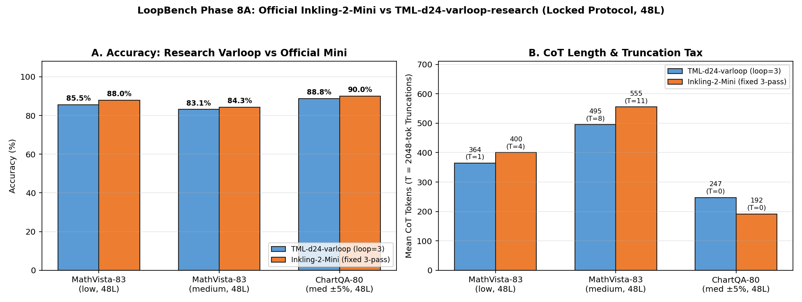
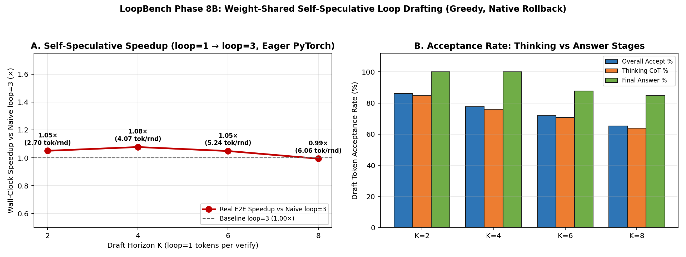
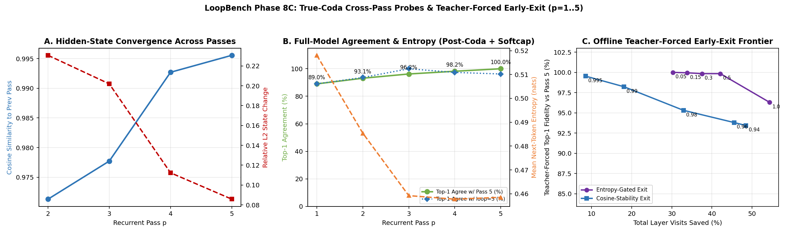
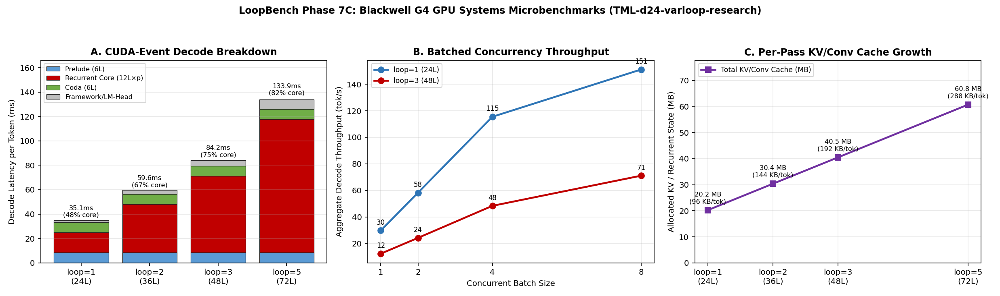

# LoopBench

**Measuring Accuracy–Latency–Memory Trade-offs of Latent Looping and Explicit Reasoning in Multimodal Inference.**

LoopBench is a reproducible multimodal inference benchmark and evaluation harness built around `thinkingmachines/TML-d24-varloop-research` (`c90921bd5f78df6c8168173b9f8a3a850320c594`) and official `thinkingmachines/Inkling-2-Mini` (`c9d028302cd0f035fdf8e7e91f089a4ce94d2195`) on NVIDIA RTX PRO 6000 Blackwell Server Edition (96 GB). Across **Phases 1–8** (`3,000+` real GPU evaluations + `120`-image independent blind multimodal QA + strict out-of-fold online routing + Blackwell CUDA-event systems profiling + native-crop self-speculative loop drafting + `1,920`-step True-Coda cross-pass probes), it isolates the causal effects of **latent pass depth** (`loop_num_passes ∈ {1, 2, 3, 5}` → `24 / 36 / 48 / 72` verified effective layers) and **explicit reasoning effort** (`none / low / medium / high`) across synthetic charts, Euclidean geometry, real-world `ChartQA-80`, and hard real-world math (`MathVista-Hard-83`).

> **Precision & Loader Transparency**: Both pinned repositories natively store NVFP4/MXFP8 + BF16 weights (~`19.5 GB`). Under stock HuggingFace `transformers 5.24.1` (without external NVIDIA ModelOpt kernels), **every Phase 2–8 run across both `varloop` and `Inkling-2-Mini` executes on the non-native BF16 fallback path** (~`50.6–51.9 GB` VRAM), verified to have **`0` missing, `0` unexpected, and `0` mismatched keys** ([model_load_reports.json](artifacts/phase8a_mini/model_load_reports.json)).

---

## Executive Results Summary (Phases 1–8 Completed)

| Phase | Scope & Dataset | Key Result (with Exact Statistical Controls) | Report |
| :---: | --- | --- | --- |
| **1** | Deterministic CPU/mock pipeline, 12-template generator, crash-resilient JSONL storage, 5-way error taxonomy, cluster bootstrap CI + exact McNemar test | Schema v2 locked; parser verified against all `32` historical GPU JSONLs (`1` prediction change on `chartqa-011-q2`, `0` accuracy changes) | [FINAL_PLAN.md](docs/FINAL_PLAN.md) |
| **2** | Colab G4 Blackwell verification, causal `loop=1` vs `loop=3` hook check, Serving Backend Gate & 12-Q decoding diagnostic | Verified in-place zero-reload `24L → 48L` switching (`loads=1`), locked `Transformers` reference backend & `temperature=0.0` | [phase2_g4_probe.md](reports/phase2_g4_probe.md) |
| **3** | `smoke-48` pass curve (`loop ∈ {1,2,3,5}`, `192` evals) + `blank` / `mismatched` visual leakage gate (`96` evals) | Visual grounding gate passed (`97.9%` correct vs `0.0%` blank / `2.1%` mismatched); `VRAM +0.34%` across `3×` depth | [phase3_smoke48.md](reports/phase3_smoke48.md) |
| **4** | Main synthetic suite `synth-240` (`120` images × `2` Qs, `24` `v1+v2` templates, `960` GPU evals, `effort="medium"`) + blind `Gemini 4 Argon` QA (`120/120` clear, `97.5%`) | `93.75% → 95.42%` (`loop=1→5`, McNemar `p=0.481`, `3.62×` P50 latency); total errors `15 / 17 / 15 / 11` (wrong `10→5`, trunc `5/10/8/6`); CoT `-10.9%`; `VRAM +0.48%` (`+243 MB`); `trigger_synth320=false` | [phase4_synth240.md](reports/phase4_synth240.md), [argon_multimodal_audit.md](reports/argon_multimodal_audit.md) |
| **5** | **5A**: `4×3` Explicit Effort × Latent Pass matrix (`effort48`, `576` evals). **5B**: Real-world `ChartQA-80` holdout (`320` evals) | **5A**: `low + loop=3` peaks at `97.9%` (`47/48`, `0` wrong, `+8.33%` vs `low+loop=1` & `none+loop=3`, P50 `-26.7%`), though exact McNemar is **not significant (`p=0.125`, `4/0` flips)** across 12 cells and all 4 repairs are paired red-`?` distractors. **5B**: `ChartQA-80` saturates at `loop=1` (`90.0%` relaxed / `92.5%` pct-norm, `3.89×` faster than `loop=5`) | [phase5_effort_holdout.md](reports/phase5_effort_holdout.md) |
| **6** | Offline Router & Cascade Oracles across Phase 4 & 5 traces + Cross-Pass CoT Failure/Repair Audit | Offline Router Oracle upper bound reaches `98.75%` at `3.38×` speedup on `synth-240` (`70.4%` GPU-s saved) and `2.09×` speedup on `effort48` (note: Oracle ≥ base by definition); exposes 3 CoT flip mechanisms (target-swap repair, pixel-ruler over-calibration, high-effort truncation) | [phase6_oracle_systems.md](reports/phase6_oracle_systems.md) |
| **7A** | Strict anti-leakage Out-of-Fold Online Routing (`image_id` 5-Fold, LOTO `k=24`, Zero-Shot transfer across `1,856` traces) | Exposes Oracle Gap: post-pass-1 CoT cascades fail on `synth-240` (`93.3%–94.6%`); `PreGen Ridge` hits `96.25% @ 2.24×` speedup in-domain but weight audit reveals reliance on synthetic prompt structure | [phase7a_online_routing.md](reports/phase7a_online_routing.md) |
| **7B / 7C** | **7B**: Hard real-world `MathVista-Hard-83` (`2×2` grid `332` evals + `83` blank-image control). **7C**: Blackwell CUDA-Event breakdown, `bs ∈ {1,2,4,8}` scaling & KV cache ablation | **7B**: `low_loop3` (`85.54%`, trunc `7→1`, CoT `-25.4%`) beats `medium` point estimates (`78.31%/83.13%`, McNemar `p=0.109/0.625`) and `low_loop1` (`83.13%`, `+2.41%`, `p=0.727`, n.s.); blank control = `6.02%` (`+77.11 pp` visual gain); online routing has only `n=5` positive flips (`HardFail` `85.54% @ 28.5s`, `Zero-Shot PreGen` `85.54% @ 21.5s`, `CoT>=600` `87.95% @ 38.5s`, OOF `PreGen` `80.7%`). **7C**: `DynamicCache` adds `+48 KB/tok/pass` within `<=1024`-tok sliding window (~`8 KB/tok/pass` beyond `1024`); `bs=1→8` scales decode `5.07×–5.76×` (`151.1 / 71.1 tok/s`) within `51.8 GB` VRAM | [phase7b_mathvista_and_7c_systems.md](reports/phase7b_mathvista_and_7c_systems.md) |
| **8** | **8A**: Official `Inkling-2-Mini` (`48L`, `bs=4`, `329` evals + `bs=1/4` check + systems probe). **8B**: Native-crop self-speculative `loop=1→3` (`K∈{2,4,6,8}`) + `draft=3` control. **8C**: True-Coda + `logit_softcap` cross-pass probes (`20` items × `5` passes, `1,920` steps) | **8A**: Official Mini hits `87.95%` `MathVista-83 (low)` (`+2.41 pp` vs varloop, `p=0.727`, `6.02%` blank) & `90.0% / 92.5%` `ChartQA-80` (`p=1.000`), CoT `+10–12%` longer on MathVista & `-22.5%` shorter on ChartQA. **8B**: Native `activate_past_recording()` + `crop(-n)` cuts rollback **`140×`** (`14.3% → 0.13%`), flipping net E2E speedup positive to **`1.050×` (`K=2`), `1.077×` (`K=4`, peak `1.28×`), `1.049×` (`K=6`)**; `draft=3` control (`4/4` diverge) + logit margins prove non-bit-exactness (`exact=2–4/10`) is BF16 `seqlen>1` vs `seqlen==1` + MoE routing drift. **8C**: True-Coda entropy drops `0.518 → 0.459` (`p1→p3`) then plateaus; `F->T` ≈ `T->F` (`0.463` vs `0.442`, retracting overthinking claim) while `F->F` is highest (`0.627`); offline teacher-forced `entropy <= 0.30` saves **`27.2%` total layer visits** at **`99.84%`** single-step fidelity vs. `loop=3` (`37.5%` vs. `loop=5`) | [phase8_mini_speculative_probes.md](reports/phase8_mini_speculative_probes.md) |

> Compact verified GPU summaries, tables, and figures for **all Phases 2–8** are tracked directly under `artifacts/phase{2,3,4,5,6,7,7b_mathvista,7c_gpu_systems,8a_mini,8b_speculative,8c_probes}/`. Mock fixtures under `artifacts/mock/` are synthetic CPU test outputs, and full raw JSONL traces/logs are archived to `mydrive:inkling_loop_bench/phase{3,4,5,6,7b,7b_blank,7c,8a,8b,8c,8_rev}` via `rclone`.

---

## Setup & Verification

~~~bash
git clone https://github.com/XDE10/inkling-loop-bench.git
cd inkling-loop-bench
python -m pip install -e ".[dev]"

# Run local mock pipeline & full unit test suite
python scripts/run_mock.py --config configs/mock.yaml
PYTHONPATH=src python -m pytest -q
~~~

## Reproducing GPU & Offline Analysis Suites

~~~bash
# Phase 2 & 3 (Colab G4 Blackwell)
python scripts/run_phase2_colab_suite.py --config configs/smoke.yaml --out artifacts/phase2
python scripts/run_phase3_smoke48.py --config configs/smoke.yaml --out artifacts/phase3

# Phase 4 (synth-240 main pass-depth study)
python scripts/run_phase4_synth240.py --config configs/synth240.yaml --out artifacts/phase4

# Phase 5 (effort48 4x3 matrix + ChartQA-80 real-world holdout)
python scripts/run_phase5_suite.py \
  --effort-config configs/phase5_effort.yaml \
  --holdout-config configs/phase5_holdout.yaml \
  --out artifacts/phase5

# Phase 6 (Offline Router/Cascade Oracles + optional external audit helper)
python scripts/run_phase6_ablations.py --phase4-dir <p4_jsonls> --phase5-dir <p5_jsonls> --out artifacts/phase6

# Phase 7 (Anti-leakage OOF online routing + MathVista-Hard-83 + Blackwell GPU systems microbenchmarks)
python scripts/run_phase7_online_router.py --phase4-dir <p4_jsonls> --phase5-dir <p5_jsonls> --out artifacts/phase7
python scripts/run_phase7_mathvista.py --config configs/phase7_mathvista.yaml --out artifacts/phase7b_mathvista --efforts low,medium --passes 1,3
python scripts/run_phase7_gpu_systems.py --config configs/phase7_mathvista.yaml --image <sample_png> --out artifacts/phase7c_gpu_systems

# Phase 8 (Official Inkling-2-Mini eval + native-crop self-speculative drafting + True-Coda probes)
python scripts/run_phase8_mini_eval.py --batch-size 4 --out artifacts/phase8a_mini
python scripts/run_phase8_speculative.py --config configs/phase7_mathvista.yaml --out artifacts/phase8b_speculative
python scripts/run_phase8_probes.py --config configs/phase7_mathvista.yaml --out artifacts/phase8c_probes
~~~

## Key Visual Summary

## Scope & Methodological Limitations

- **Non-Native BF16 Reference Backend vs. Production Serving**: Both checkpoints natively use NVFP4/MXFP8 + BF16, but stock HF `transformers 5.24.1` runs BF16 eager fallback (`0` missing/unexpected/mismatched keys) without NVFP4/PagedAttention/DSpark/MTP kernels. Phase 7C measures `bs=1 → 8` aggregate decode scaling (`3.87×–5.76×`, up to `151.1 / 71.1 tok/s` for `loop=1 / 3` within `51.8 / 96 GB` VRAM) and `+48 KB/tok/pass` unshared `DynamicCache` growth within the `<=1024`-token sliding window (dropping to ~`8 KB/tok/pass` beyond `1024` tokens per model config). For production quantized roofline context, HuggingFace's Blackwell inference blog reports `157 tok/s` (vLLM) and `190.6 tok/s` (DSpark) on the same GPU under native precision.
- **Small-Sample Statistical Boundaries & Synthetic Confounds**: In Phase 4 (`synth-240`), `loop5 − loop1` (`+1.67%`, exact McNemar `p=0.481`) is non-significant, and total errors are `15 / 17 / 15 / 11` across `loop=1/2/3/5`. In Phase 5A (`effort48`, `n=48`), `low+loop=3` vs. `low+loop=1` (`+8.33%`) has a positive bootstrap CI `[+2.08%, +16.67%]` solely because `4/0` discordant flips occur—exact McNemar `p=0.125` is **not significant**, it is selected across 12 cells, and all 4 flips are paired red-`?` target-swap items. Offline Oracles are `>=` fixed bases by construction, so their positive CIs are uninformative as hypothesis tests.
- **Real-World Holdout Boundaries (`ChartQA-80` & `MathVista-Hard-83`)**: `ChartQA-80` saturates at `loop=1` (`90.0%` relaxed). On `MathVista-Hard-83` (visually grounded at `83.13%` vs `6.02%` blank), `low+loop=3` compresses CoT (`-25.4%`) and cuts truncations (`7 → 1`), but accuracy differences vs. `low+loop=1` (`+2.41%`, McNemar `p=0.727`) and `medium+loop=3` (`+2.41%`, `p=0.625`) are non-significant at `n=83`. Online routing comparisons on `MathVista-Hard-83` rest on only `n=5` positive flips, precluding strong generalization claims in either direction.
- **Offline Early-Exit & Batch-Padding Caveats**: Phase 8C's `27.2%` total layer-visit saving vs. `loop=3` (`99.84%` fidelity) is an offline single-step teacher-forced upper bound that does not model multi-step autoregressive drift or stale KV/recurrent caches on skipped passes. Phase 8A's `bs=4` left-padded evaluation matches `bs=1` on `7/8` numeric predictions (`2/8` exact text) due to BF16 kernel non-associativity.

## Locked Evaluation Protocol

- **Checkpoints**: `thinkingmachines/TML-d24-varloop-research` @ `c90921bd5f78df6c8168173b9f8a3a850320c594` and `thinkingmachines/Inkling-2-Mini` @ `c9d028302cd0f035fdf8e7e91f089a4ce94d2195`
- **Backend**: Official HuggingFace `Transformers 5.24.1` BF16 fallback (`Inkling2LoopForConditionalGeneration`, zero-reload in-place `loop_num_passes` switching with forward-hook layer count verification)
- **Pass Depths**: `1, 2, 3, 5` (`24, 36, 48, 72` verified effective layers)
- **Decoding Policy**: `temperature=0.0`, `top_p=1.0`, `repetition_penalty=1.0`, `max_new_tokens=2048`, `concurrency=1` (`bs=4` separately disclosed in Phase 8A)
- **Statistical Rigor**: Paired `image_id`-clustered bootstrap 95% confidence intervals (`B=5000`) **paired with exact two-sided McNemar tests**, predeclared `synth-320` extension rule, and `blank` / `mismatched` visual leakage controls
