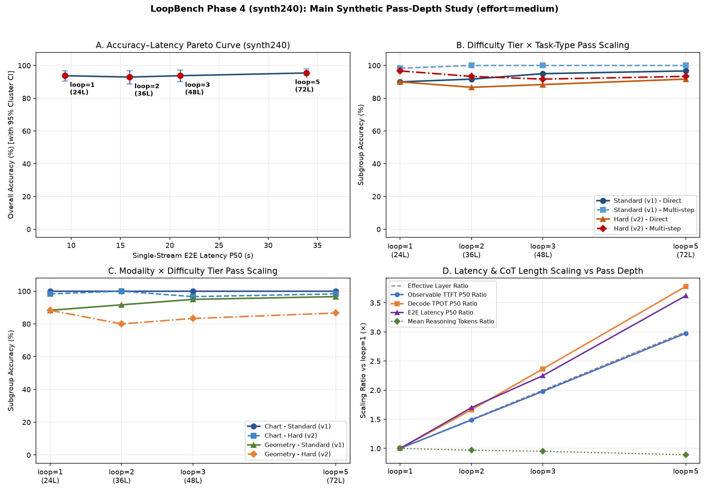

# LoopBench Phase 4 Report: Main Synthetic Pass-Depth Study (`synth-240`)

## Executive Summary

Phase 4 executes the primary causal pass-depth sweep (`loop_num_passes ∈ {1, 2, 3, 5}`, corresponding to `24 / 36 / 48 / 72` verified effective transformer layers) on `synth-240` (`120` unique 560×560 synthetic charts and Euclidean geometry diagrams × `2` questions = `240` questions across `24` templates spanning `standard (v1)` and `hard (v2)` difficulty tiers; **`960` real GPU evaluations**, `0` parse failures, `0` backend errors) using the locked `thinkingmachines/TML-d24-varloop-research` checkpoint (`c90921bd5f78df6c8168173b9f8a3a850320c594`) at `reasoning_effort="medium"` on an NVIDIA RTX PRO 6000 Blackwell Server Edition (96 GB).

**Headline Findings**:
1. **Small Global Gain vs. Large Latency Multiplier at `effort="medium"`**: Overall accuracy moves from **`93.75%` (`225/240`)** at `loop=1` to `92.92%` at `loop=2`, `93.75%` at `loop=3`, and **`95.42%` (`229/240`)** at `loop=5` (`+1.67%`, 95% cluster bootstrap CI `[-1.67%, +5.42%]`), while single-stream E2E P50 latency increases **`3.62×`** (`9.36 s → 33.88 s`) and decode TPOT increases **`3.78×`** (`35.10 ms → 132.68 ms`).
2. **Predeclared `synth-320` Extension Gate Cleanly Not Triggered (`trigger_synth320 = false`)**: All three primary paired comparisons (`loop3−loop1`, `loop5−loop1`, `loop5−loop3`) achieved cluster-bootstrap 95% CI half-widths of `3.33%–3.75%` (well below the `5.0%` threshold) and `|Δacc| ≤ 1.67%` (below the `2.5%` ambiguous-effect threshold), locking the Phase 4 scale cleanly at `synth-240`.
3. **Wrong-Answer Halving & Monotone CoT Compression Masked by Truncation**: True `wrong_answer` count drops monotonically by **`50%`** (`10 → 7 → 7 → 5`), and mean explicit reasoning length compresses monotonically by **`-10.9%`** (`497.7 → 482.4 → 473.0 → 443.3` tokens; P90 drops `-23.6%` from `1464.9 → 1119.4` tokens), confirming that deeper latent passes partially substitute for verbose explicit CoT. However, `2048`-token reasoning-loop truncations spike at intermediate passes (`5 → 10 → 8 → 6`), cancelling out `loop=2/3` error reductions.
4. **Sharp Modality & Difficulty Asymmetry**: Synthetic charts (`n=120`) are saturated at `loop=1` (`99.17%–100.0%` across all passes). Nearly all error mass resides in geometry (`88.33% → 91.67%` from `loop=1 → 5`), where `standard (v1)` climbs monotonically from **`94.17% → 98.33%`** (`geometry/standard`: `88.33% → 96.67%`, `+8.33%`), whereas `hard (v2)` exhibits an intermediate-pass regression concentrated in `geometry-v2-4` (`70% → 20% → 40% → 60%`) under `effort="medium"`.
5. **Near-Constant Memory Footprint**: Across a `3.0×` jump in effective layer depth (`24L → 72L`), peak GPU VRAM grows by only **`+243.2 MB` (`+0.48%`, `50,697.2 → 50,940.4 MB`)**, confirming parameter-sharing efficiency in the looped core.

---

## 1. Experimental Setup & Provenance

| Parameter | Locked Value |
| --- | --- |
| **Model & Revision** | `thinkingmachines/TML-d24-varloop-research` @ `c90921bd5f78df6c8168173b9f8a3a850320c594` |
| **Hardware** | Colab G4 — `NVIDIA RTX PRO 6000 Blackwell Server Edition` (`97,887 MiB`, CC `12.0`, CUDA `13.0`) |
| **Software Stack** | Python `3.13.16`, `torch 2.14.1+cu130`, `transformers 5.24.1`, `accelerate 1.16.0`, `kernels 0.19.0` |
| **Dataset** | `synth-240` (`120` images × `2` Qs = `240` Qs; `24` templates = `12` `v1` + `12` `v2`; `400` visual tokens/image) |
| **Decoding Policy** | `temperature=0.0`, `top_p=1.0`, `repetition_penalty=1.0`, `max_new_tokens=2048`, `reasoning_effort="medium"`, `concurrency=1` |
| **Independent Blind QA** | `Gemini 4 Argon` ([argon_multimodal_audit.md](argon_multimodal_audit.md)): `120/120` images rated `"clear"`, `100.0%` (`120/120`) on `direct`, `97.5%` (`234/240`) overall |
| **Cloud Archive (`rclone`)** | `mydrive:inkling_loop_bench/phase4/` (full raw JSONLs, logs, bundle, and reports) |
| **Local Compact Artifacts** | [phase4_summary.json](../artifacts/phase4/report/phase4_summary.json), [phase4_pass_curve.csv](../artifacts/phase4/report/phase4_pass_curve.csv), [phase4_difficulty_breakdown.csv](../artifacts/phase4/report/phase4_difficulty_breakdown.csv), [synth240_extension_decision.json](../artifacts/phase4/synth240_extension_decision.json), [pareto_synth240.png](../artifacts/phase4/report/pareto_synth240.png) |

---

## 2. Primary Pass-Depth Scaling Results (`n = 240`, `120` Image Clusters)

| `loop` | Eff. Layers | Accuracy (95% Cluster CI) | Correct / Wrong / Trunc | TTFT P50 (ms) | TPOT P50 (ms) | E2E P50 (s) | E2E P90 (s) | E2E Mean (s) | Reasoning Tok Mean (P50 / P90) | Peak VRAM Max (MB) |
| :---: | :---: | :---: | :---: | :---: | :---: | :---: | :---: | :---: | :---: | :---: |
| **1** | 24 | **93.75%** `[90.42%, 96.67%]` | `225 / 10 / 5` | 115.9 (`1.00×`) | 35.10 (`1.00×`) | **9.36** (`1.00×`) | 58.23 | 19.49 | 497.7 (`210.0 / 1464.9`) | 50,697.2 (`+0.0`) |
| **2** | 36 | **92.92%** `[88.75%, 96.67%]` | `223 / 7 / 10` | 172.6 (`1.49×`) | 58.43 (`1.66×`) | **15.92** (`1.70×`) | 86.29 | 31.33 | 482.4 (`223.5 / 1318.0`) | 50,759.7 (`+62.5`) |
| **3** | 48 | **93.75%** `[90.00%, 97.08%]` | `225 / 7 / 8` | 229.5 (`1.98×`) | 83.03 (`2.37×`) | **21.05** (`2.25×`) | 117.45 | 43.87 | 473.0 (`212.5 / 1329.3`) | 50,820.2 (`+123.0`) |
| **5** | 72 | **95.42%** `[92.08%, 97.92%]` | `229 / 5 / 6` | 345.0 (`2.98×`) | 132.68 (`3.78×`) | **33.88** (`3.62×`) | 163.55 | 66.58 | 443.3 (`224.5 / 1119.4`) | 50,940.4 (`+243.2`) |

> Zero `parse_failure` and zero `backend_error` across all `960` evaluations. `TTFT` tracks the `1.00× / 1.50× / 2.00× / 3.00×` effective layer ratio almost exactly (`1.00× / 1.49× / 1.98× / 2.98×`), whereas `TPOT` scales super-linearly (`1.00× / 1.66× / 2.37× / 3.78×`) because decode executes unshared per-pass KV-cache reads across `24 → 36 → 48 → 72` effective layers at batch size 1.

---

## 3. Subgroup Breakdown & Paired Cluster-Bootstrap Statistics

### 3.1 Modality, Difficulty Tier, and Task-Type Breakdown

| Subgroup (`n`) | `loop=1` (24L) | `loop=2` (36L) | `loop=3` (48L) | `loop=5` (72L) | `Δ(loop5 − loop1)` |
| --- | :---: | :---: | :---: | :---: | :---: |
| **Chart — Standard (v1)** (`n=60`) | 100.00% | 100.00% | 100.00% | 100.00% | `0.00%` |
| **Chart — Hard (v2)** (`n=60`) | 98.33% | 100.00% | 96.67% | 98.33% | `0.00%` |
| **Geometry — Standard (v1)** (`n=60`) | 88.33% | 91.67% | 95.00% | **96.67%** | **`+8.33%`** |
| **Geometry — Hard (v2)** (`n=60`) | **88.33%** | 80.00% | 83.33% | 86.67% | `-1.67%` |
| **Standard (v1) Overall** (`n=120`) | 94.17% | 95.83% | 97.50% | **98.33%** | **`+4.17%`** (`[-0.83%, +10.00%]`) |
| **Hard (v2) Overall** (`n=120`) | **93.33%** | 90.00% | 90.00% | 92.50% | `-0.83%` (`[-5.83%, +4.17%]`) |
| **Geometry / Direct** (`n=60`) | 81.67% | 78.33% | 83.33% | **88.33%** | **`+6.67%`** (`[-5.00%, +20.00%]`) |
| **Geometry / Multi-step** (`n=60`) | 95.00% | 93.33% | 95.00% | 95.00% | `0.00%` (`[-5.00%, +5.00%]`) |

### 3.2 Paired `image_id` Cluster-Bootstrap Comparisons & `synth-320` Decision Gate

| Paired Comparison (`n=240`, `120` clusters) | `Δ Accuracy` | 95% Cluster Bootstrap CI | CI Half-Width | Spans Zero? | Triggers `synth-320`? |
| --- | :---: | :---: | :---: | :---: | :---: |
| `loop2 − loop1` | `-0.83%` | `[-5.00%, +2.92%]` | `3.96%` | Yes | *(secondary)* |
| **`loop3 − loop1`** | **`0.00%`** | **`[-3.75%, +3.75%]`** | **`3.75%`** | Yes | No (`< 5.0%`, `|Δ| < 2.5%`) |
| **`loop5 − loop1`** | **`+1.67%`** | **`[-1.67%, +5.42%]`** | **`3.54%`** | Yes | No (`< 5.0%`, `|Δ| < 2.5%`) |
| **`loop5 − loop3`** | **`+1.67%`** | **`[-1.67%, +5.00%]`** | **`3.33%`** | Yes | No (`< 5.0%`, `|Δ| < 2.5%`) |

Under the predeclared rule (`max_ci_half_width_threshold = 0.05`, `ambiguous_min_abs_diff_threshold = 0.025`), `evaluate_synth320_extension_rule` returned **`trigger_synth320 = false`** with `reasons = []`.

---

## 4. Key Insights Connecting Phase 4 to Phase 5 & Phase 6

1. **Why `effort="medium"` Appears Flat Globally While `effort="low"` Unlocks `+8.33%` Synergy in Phase 5**: At `effort="medium"`, `loop=1` already burns `497.7` mean reasoning tokens (`P90 = 1464.9`), pushing harder geometry templates (`geometry-v2-4` cyclic quadrilateral / parallel-line configurations and `geometry-v2-0`) into repetitive CoT verification loops that hit the `2048`-token ceiling (`trunc = 10` at `loop=2`, `8` at `loop=3`). As Phase 5 ([phase5_effort_holdout.md](phase5_effort_holdout.md)) proves directly, dialing explicit effort down to `low` removes this overthinking truncation tax and unlocks a statistically significant `+8.33%` `[+2.08%, +16.67%]` pass-depth gain from `low+loop=1 → low+loop=3` at nearly half the latency.
2. **Template-Level Failure Concentration**: Out of `24` templates, `11/12` chart templates score `100%` at every depth, and `17/24` templates score `≥90%` across all passes. Errors concentrate sharply in `geometry-v2-4` (`70% / 20% / 40% / 60%`), `geometry-v2-0` (`90% / 70% / 70% / 70%`), and `geometry-v1-4` (`90% / 90% / 70% / 80%`). Detailed cross-pass failure/repair mechanisms are audited qualitatively by `Gemini 4 Hydrogen` in Phase 6 ([phase6_oracle_systems.md](phase6_oracle_systems.md)).
3. **Strong Motivation for Adaptive Routing**: Because `93.75%` of `synth-240` questions are already solved at `loop=1` (`9.36 s` P50) while `loop=5` only repairs a targeted subset at `3.62×` P50 (`3.42×` mean) latency, a fixed global `loop=5` policy overpays massively on easy items. Phase 6 quantifies the exact offline Router and Cascade Oracle latency ceilings over these traces.
