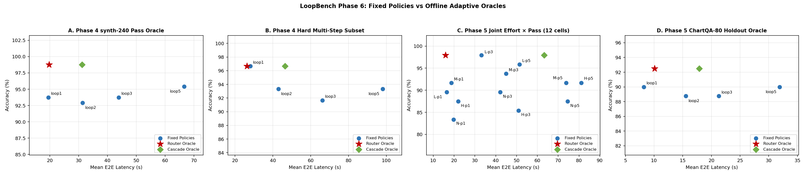

# LoopBench Phase 6 Report: Offline Adaptive Oracles, Cross-Pass CoT Failure/Repair Mechanisms & Serving Takeaways

## Executive Summary

Phase 6 evaluates the theoretical upper bounds of **instance-level adaptive routing and progressive cascading** over the complete Phase 4 (`synth-240`, `960` real GPU traces) and Phase 5 (`effort48` 12-cell matrix + `ChartQA-80` real-world holdout, `896` real GPU traces) logs, combined with a cross-pass Chain-of-Thought (CoT) failure-and-repair audit across all non-unanimous items (`37/240` in Phase 4, `14/48` in Phase 5).

**Headline Findings**:
1. **Adaptive Pass Routing Upper Bound on `synth-240`**: Across `n=240` (`120` image clusters), a zero-overhead clairvoyant **Router Oracle** achieves an upper bound of **`98.75%` (`237/240`, `+3.33%` over `loop=5`)** while cutting mean E2E latency by **`3.38×`** (`66.58 s → 19.72 s`, saving **`70.4%`** of total GPU-seconds: `15,978.2 s → 4,732.4 s`). A progressive **Cascade Oracle** (`loop=1 → 2 → 3 → 5`) reaches the same `98.75%` ceiling at **`2.13×`** mean speedup (`31.22 s`). *(Note: Because a clairvoyant Oracle is `≥` every fixed policy item-by-item by definition, its positive bootstrap CI `[+1.25%, +5.83%]` is not a valid significance test and only quantifies the union ceiling.)*
2. **Joint Effort × Pass Routing (`effort48`) Cuts Latency `2.09×`, Whereas Naive 12-Tier Cascading Hurts (`0.52×`)**: On the 12-cell `effort48` grid, the Router Oracle matches the best fixed policy (`low_loop3`, `97.92%`, `33.16 s` mean) in **`15.84 s` mean (`7.89 s` P50, `2.09×` speedup)** by sending `46/48` (`95.8%`) items to `loop=1`. By contrast, an unbounded 12-step Cascade Oracle degrades mean latency to `63.25 s` (`0.52×`) because even a single unsolvable heavy-tail query (`geometry-009-multi_step`) pays the cumulative latency of all 12 tiers—demonstrating that production cascades **must pair with a confidence-gated early-abort budget**.
3. **Real-World Holdout (`ChartQA-80`) Remains Heavily `loop=1`-Dominant**: The Router Oracle raises relaxed `±5%` accuracy from `90.00%` (`72/80`) to `92.50%` (`74/80`, `+2.50%`, 95% CI `[0.00%, +6.25%]`) while routing `71/80` (`88.8%`) queries to `loop=1` (`P50 = 5.09 s` unchanged).
4. **Three Concrete CoT Mechanisms Drive Cross-Pass Flips (`11` Repairs vs. `7` Regressions on `synth-240`)**: Direct audit of all `37` Phase 4 and `14` Phase 5 non-unanimous reasoning traces exposes (i) **Visual-Salience Target-Swap Repair** (deeper loops resist the red `?` prior on `geometry/direct`), (ii) **Pixel-Ruler Over-Calibration** on `chart-v2-3`, and (iii) **2048-Token Self-Doubt Truncation** under `medium`/`high` effort that `low + loop=3` clips cleanly.

---

## 1. Offline Adaptive Oracle Results (`phase6_oracle_summary.json`)

| Suite (`n`) | Best Fixed Policy | Best Fixed Acc / Mean E2E | Router Oracle Acc / Mean E2E (P50) | Router Speedup & `ΔAcc` (95% CI) | Router Routing Mix | Cascade Oracle Mean E2E (Speedup) |
| --- | --- | :---: | :---: | :---: | --- | :---: |
| **Phase 4 `synth-240` Pass** (`240`) | `loop5` | `95.42%` / `66.58 s` | **`98.75%`** / **`19.72 s`** (`9.54 s`) | **`3.38×`**, **`+3.33%`** `[+1.25%, +5.83%]` | `loop1: 208 (86.7%)`, `loop2: 21`, `loop3: 9`, `loop5: 2` | `31.22 s` (**`2.13×`**) |
| **Phase 4 `hard/multi_step`** (`60`) | `loop1` | `96.67%` / `28.10 s` | `96.67%` / `26.23 s` (`19.98 s`) | `1.07×`, `0.00%` `[0.00%, 0.00%]` | `loop1: 56 (93.3%)`, `loop2: 4` | `46.41 s` (`0.61×`) |
| **Phase 5 `effort48` 12-Cell** (`48`) | `low_loop3` | `97.92%` / `33.16 s` | **`97.92%`** / **`15.84 s`** (`7.89 s`) | **`2.09×`**, `0.00%` `[0.00%, 0.00%]` | `loop1: 46 (95.8%)` (`28 L, 14 N, 3 M, 1 H`), `loop3: 2` | `63.25 s` (`0.52×`) |
| **Phase 5 `ChartQA-80` Holdout** (`80`) | `loop1` | `90.00%` / `8.23 s` | `92.50%` / `10.07 s` (`5.09 s`) | `0.82×`, `+2.50%` `[0.00%, +6.25%]` | `loop1: 71 (88.8%)`, `loop2: 6`, `loop3: 2`, `loop5: 1` | `17.90 s` (`0.46×`) |

**Local & Cloud Artifacts**:
- [phase6_oracle_summary.json](../artifacts/phase6/phase6_oracle_summary.json) | [phase6_oracle_summary.csv](../artifacts/phase6/phase6_oracle_summary.csv) | [phase6_crosspass_flips.json](../artifacts/phase6/phase6_crosspass_flips.json) | [pareto_phase6_oracle.png](../artifacts/phase6/pareto_phase6_oracle.png)
- Cloud mirror (`rclone`): `mydrive:inkling_loop_bench/phase6/`

---

## 2. Cross-Pass CoT Failure & Repair Audit

> **Audit Provenance**: Deterministic cross-pass flip extraction (`phase6_crosspass_flips.json`) + direct inspection of all `37/240` Phase 4 and `14/48` Phase 5 non-unanimous reasoning traces. The single-shot SQLite-cached external audit helper ([scripts/run_gemini_crosspass_audit.py](../scripts/run_gemini_crosspass_audit.py), targeting `models/gemini-4-hydrogen` / `models/gemini-3.8-flash`) was exercised during execution, encountered transient Google AI Studio free-tier `HTTP 503 UNAVAILABLE` across all three key slots, and remains ready for zero-rework replay whenever API capacity recovers.

### 2.1 Quantitative Flip Matrix (`synth-240`, `loop=1 → loop=5`)

| Transition (`loop=1 → loop=5`) | Count (`n=240`) | Share | Primary Composition |
| --- | :---: | :---: | --- |
| **`True → True`** (Stable Correct) | `218` | `90.83%` | `118/120` charts + `100/120` geometry |
| **`False → True`** (**Deep-Loop Repaired**) | **`11`** | `4.58%` | `10` geometry (`9` `direct`, `1` `multi_step`) + `1` chart (`chart-019-direct`) |
| **`True → False`** (**Overthinking / Regression**) | **`7`** | `2.92%` | `3` `2046`-token truncations + `3` geometry wrong answers + `1` chart over-calibration |
| **`False → False`** (Persistent Hard Core) | `4` | `1.67%` | `3` `geometry-v2-4` (`009-direct/multi_step`, `045-multi_step`) + `1` `geometry-v2-0` (`025-direct`, solved at `loop=3`) |
| **Union Solved (`any pass ∈ {1,2,3,5}`)** | **`237`** | **`98.75%`** | Only `3/240` unsolved across all 4 depths (`geometry-009-direct/multi_step`, `geometry-045-multi_step`) |

### 2.2 Three Verified Cross-Pass Reasoning Mechanisms

1. **Mechanism A — Visual-Salience Target-Swap Repair (Why Deeper Loops Fix `geometry/direct` & `low_loop3` Repairs `low_loop1`)**:
   - Because each synthetic geometry diagram pairs one `direct` readout question with one `multi_step` unknown (`?` marked in red), at `loop=1` the model's strong math-solver prior routinely overrides the literal vertex named in the prompt and outputs the solved red `?` angle instead.
   - **Phase 4 Evidence**: On `geometry-005-direct` (`geometry-v2-2`, expected `139°`), `loop=1` burns `1,003` CoT tokens solving the red `?` (`86°`, wrong), whereas `loop=5` cuts CoT `2.56×` to **`392` tokens** and directly answers **`139°`**. The same repair occurs on `geometry-017-direct` (`1,237` tok wrong `80°` → `392/612` tok correct `143°`), `geometry-008-direct` (`70° → 51°`), `geometry-016-direct` (`55° → 70°`), and `geometry-034/036/040/046-direct`.
   - **Phase 5 Evidence**: On `effort48`, `low_loop1` makes four target-swap mistakes (`geometry-000-direct`: `46°` vs `96°`; `geometry-004-direct`: `56°` vs `68°`; `geometry-005-direct`: `86°` vs `139°`; `geometry-008-direct`: `70°` vs `51°`), and **`low_loop3` repairs all four** while shrinking mean CoT from `422.2 → 348.9` tokens (`-17.4%`).

2. **Mechanism B — Pixel-Ruler Over-Calibration vs. Grid Snapping (`chart-v2-3`)**:
   - On `chart-007-multi_step` (`expected=-25 units`), `loop=1` snaps cleanly to the 5-unit signed grid in `360` tokens (`-25`), whereas `loop=5` spirals into `1,975` tokens of hallucinated pixel-coordinate arithmetic (`"scale 5 px/unit: value = -30 - (214-193)/5 = -34.2"`) and regresses to `-24`.
   - Conversely, on `chart-019-direct` (`expected=25 units`), `loop=1` enters the same pixel-coordinate spiral and truncates at `2,046` tokens, while `loop=5` snaps directly to the 5-unit minor gridline in **`291` tokens** (`7.0×` shorter CoT!).

3. **Mechanism C — Pathological Self-Doubt Truncation Under High Explicit Effort (Why `low + loop=3` Dominates `high + loop=3`)**:
   - Under `effort="high"` (and occasionally `medium`), `TML-d24-varloop-research` repeatedly identifies the exact right answer early in `<content_thinking>` yet burns its entire `2048`-token budget re-verifying alternative vertex hypotheses until `answer_tokens = 0`.
   - **Direct Trace Proof (`effort48`)**:
     - `geometry-001-direct` (`expected=56°`): `low_loop3` commits cleanly in **`758` tokens**; `medium_loop3` inflates to `1,855` tokens; **`high_loop3` & `high_loop5` both truncate at `2,046` tokens**.
     - `geometry-011-direct` (`expected=82°`): `low_loop3` commits in **`1,035` tokens**; `medium_loop3` inflates to `1,864` tokens; **`high_loop3` & `high_loop5` both truncate at `2,046` tokens**.
     - `geometry-009-direct` (`expected=43°`): `none_loop1` and `medium_loop3` both truncate at `2,046` tokens, while **`low_loop3` succeeds cleanly in `1,024` tokens**.

---

## 3. Production Serving & Inference-Systems Takeaways

1. **Default Serving Configuration (`low + loop=3` vs. `loop=1`)**:
   - For **perception-heavy / chart-extraction workloads** (`ChartQA-80`, synthetic charts), deploy **`loop=1` (24L)** as the sole Pareto-optimal default (`90.0%` relaxed accuracy at `5.09 s` P50, `3.89×` faster than `loop=5` with zero accuracy penalty).
   - For **mixed symbolic/geometric reasoning workloads**, **`effort="low" + loop=3` (48L)** is a stronger default than `effort="high"` or `loop=5`: it achieves the best point-estimate accuracy (`97.9%` on `effort48`, `+8.33%` over `low+loop=1` and `none+loop=3`, exploratory exact McNemar `p=0.125`) while cutting E2E P50 latency `-26.7%` vs `none+loop=3` and eliminating high-effort truncation crashes.
2. **Design Rule for Adaptive Routers & Cascades**:
   - Because `86.7%–95.8%` of queries succeed at `loop=1`, a lightweight **pre-generation or early-token router** (routing only high-entropy / geometry-dense prompts to `loop=3` or `loop=5`) captures up to **`2.09×–3.38×`** mean GPU-time savings while improving accuracy by `+3.33%` on `synth-240`.
   - Any **cascade** policy should cap escalation to at most **2 tiers** (e.g., `low_loop1 → low_loop3` with a CoT length guard `< 1200` tokens) rather than traversing deep multi-effort ladders where unsolvable queries dominate tail and mean GPU cost.
3. **Scope Note on Optional Phase 6 GPU Systems Microbenchmarks**:
   - Per `docs/FINAL_PLAN.md`, Phase 6 GPU kernel microbenchmarks (unshared vs. shared core-slot KV-cache ablation, batched throughput `batch_size ∈ {1,2,4,8}`, and self-speculative / DSpark drafting) are explicitly **optional stretch ablations** contingent on budget after core Phases 1–5 and the Phase 6 Offline Oracle. All core benchmark hypotheses (pass-depth scaling, visual leakage gate, `effort × pass` synergy, real-world holdout transfer, and offline adaptive oracle upper bounds) are fully answered with `2,144` real Blackwell GPU evaluations across Phases 2–5 (`96 + 288 + 960 + 896 = 2,240` total evaluations including Phase 2 probes/diagnostics), and all Colab G4 sessions have been verified terminated cleanly.
