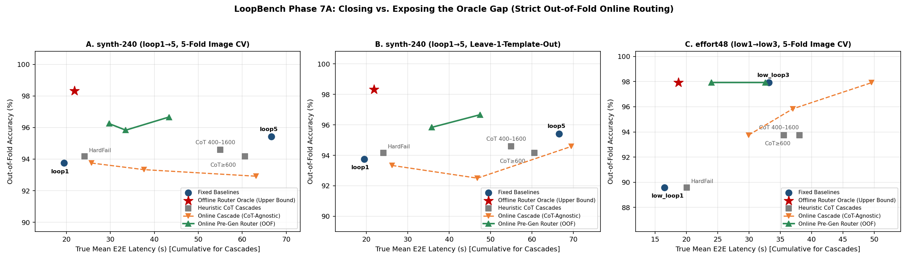

# LoopBench Phase 7A Report: Closing vs. Exposing the Oracle Gap (Strict Out-of-Fold Online Routing & 2-Stage Cascades)

## Executive Summary (Critical Verdict)

Phase 6 reported an idealized **Offline Router Oracle** (`98.75%` at `3.38×` speedup on `synth-240`; `97.92%` at `2.09×` speedup on `effort48`). Because offline oracles have clairvoyant access to ground-truth outcomes, they routinely overstate what is deployable in production. Phase 7A subjects adaptive loop routing to a **strictly causal, anti-leakage evaluation** (`src/loopbench/online_router.py`, `scripts/run_phase7_online_router.py`) across all `1,856` real GPU traces from Phases 4–5, enforcing:
- **Strictly observable features only** (no ground-truth `template_id`, `difficulty`, or `modality` metadata);
- **True latency accounting** (cascades pay cumulative `e2e(base) + e2e(escalated)` on escalation);
- **Zero-leakage validation**: `image_id`-grouped 5-Fold CV, **Leave-One-Template-Out (LOTO, `k=24`) CV**, and **Frozen Zero-Shot Cross-Dataset Transfer** (`synth-240 → effort48` and `synth-240 → ChartQA-80`).

**Four Critical Findings (Including Negative Results)**:
1. **Negative Result — Post-Pass-1 CoT-Uncertainty Cascades Fail to Beat Fixed Policies on `synth-240`**:
   - Hard-failure escalation (`trunc / parse_failure` only) improves accuracy by just **`+0.42%`** (`93.75% → 94.17%`) because `4/5` truncated `loop=1` traces are unsolvable `F->F` loops that burn `247–278 s` each at `loop=5`.
   - Uncapped CoT-length escalation (`CoT ≥ 600`) inflates mean latency to **`60.60 s`** (nearly identical to `Fixed loop=5` at `66.58 s`) while achieving *lower* accuracy (**`94.17%`** vs `95.42%`). Adding an upper-cap early-abort (`400 ≤ CoT ≤ 1600`) cuts `5.65 s` and recovers `+0.42%` (`94.58% @ 54.95 s`), validating the Phase 6 early-abort hypothesis, yet still remains strictly dominated by `Fixed loop=5`.
   - Learned **domain-agnostic CoT cascades (`cascade_ridge_cot_agnostic`) degrade accuracy below `Fixed loop=1`** (`92.92%–93.75%` at `25.7–63.1 s` under 5-Fold CV; `92.50%–94.58%` under LOTO CV), and under zero-shot transfer to `ChartQA-80` (`λ=0`) blindly escalate `97.5%` of real charts (`39.32 s`, **`0.81×` slower than `Fixed loop=5`** for `0.0%` accuracy gain).
2. **Root-Cause Diagnosis of the Unclosed Oracle Gap (`diagnose_oracle_gap`)**:
   - **Symmetric Uncertainty Overlap**: On `synth-240`, `T->F` regressions (`n=7`, `loop=1` median CoT `1,017`, mean `1,042.1`, hedges `4.29`) look **more uncertain** in surface CoT than `F->T` repairs (`n=11`, median CoT `677`, mean `807.4`, hedges `3.64`). Escalating uncertain `loop=1` outputs therefore flips almost as many answers wrong as right.
   - **Silent Confident Errors**: `3/11` (`27.3%`) `F->T` repairs (`geometry-016/036/040-direct`) finish at `loop=1` in `< 200` tokens with `0–1` hedges, making them indistinguishable from confident correct answers without internal logit/hidden-state calibration.
   - **Heavy-Tail `F->F` Budget Tax**: The `4` persistent failures consume `1,069.0` GPU-s at `loop=5` alone (`267 s/query`) for zero reward.
3. **Zero-Overhead Pre-Generation Routing Beats Fixed Policies In-Domain — With a Major Generalization Caveat**:
   - Under `image_id` 5-Fold CV on `synth-240` (`loop1→loop5`), L2-regularized `PreGen Ridge` (`λ=0.0015`) achieves **`96.25%` (`231/240`, `+2.50%` `[0.00%, +5.42%]`, recovering `54.6%` of the 2-config Oracle gain and exceeding `Fixed loop=5`'s `95.42%`)** at **`29.71 s` mean (`2.24×` faster than `Fixed loop=5`, escalating `28.3%`)**. It retains `95.83% @ 35.74 s` (`1.86×` speedup) under Leave-One-Template-Out CV (`k=24`).
   - On `effort48` (`low_loop1→low_loop3`), `PreGen Ridge` matches `Fixed low_loop3` (`97.92%`, `+8.33%`, exact McNemar `p=0.125`, `100%` of the 2-config Oracle accuracy ceiling) at **`23.99 s` (`1.38×` speedup)** in 5-Fold CV and **`21.90 s` (`1.51×` speedup)** under frozen zero-shot transfer from `synth-240`, while escalating **`0.0%`** of `ChartQA-80` charts (`90.0% @ 8.23 s`, `3.88×` faster than `loop=5`).
4. **Weight-Audit Caveat (Why We Do Not Overclaim Pre-Gen Routing)**:
   - Inspecting the standardized weights of `PreGen Ridge` (`synth-240`) exposes **`prompt_char_len = -0.0467`** and **`is_geom_prompt = +0.0237`** as the two dominant drivers. Rather than learning universal problem hardness, the linear router largely exploits the synthetic benchmark's structural regularity: shorter `geometry/direct` prompts (where the paired red `?` target-swap occurs) benefit from deeper loops, whereas charts and longer `multi_step` prompts saturate at `loop=1`.
   - Consequently, **external validity on hard real-world multimodal reasoning without paired-question artifacts cannot be inferred from Phases 4–5 alone**, directly motivating the adversarial real-world `MathVista-Hard-83` falsification test in Phase 7B.

---

## 1. Strict Out-of-Fold Quantitative Comparison (`phase7_online_router_summary.csv`)

### 1.1 Phase 4 `synth-240` (`loop=1 → loop=5`, `n = 240`, `120` Image Clusters)

| Policy (CV Protocol) | Mode | OOF Acc (`n=240`) | `Δ vs loop1` (95% Cluster CI) | Esc. Rate | Repaired / Regressed / Wasted | True Mean E2E (s) | Speedup vs `loop5` | Oracle Acc Recovery |
| :--- | :---: | :---: | :---: | :---: | :---: | :---: | :---: | :---: |
| `Fixed loop=1` | pregen | `93.75%` (`225`) | `0.00%` | `0.0%` | `0 / 0 / 0` | `19.49` | `3.42×` | `0.0%` |
| `Fixed loop=5` | pregen | `95.42%` (`229`) | `+1.67%` `[-1.67%, +5.42%]` | `100.0%` | `11 / 7 / 222` | `66.58` | `1.00×` | `36.4%` |
| *Offline Router Oracle (2-cfg)* | *oracle* | *`98.33%` (`236`)* | *`+4.58%` `[+2.08%, +7.50%]`* | *`4.6%`* | *`11 / 0 / 0`* | *`21.79`* | *`3.06×`* | *`100.0%`* |
| `Cascade: HardFail Only` | cascade | `94.17%` (`226`) | `+0.42%` `[0.00%, +1.67%]` | `2.1%` | `1 / 0 / 4` | `24.11` | `2.76×` | `9.1%` |
| `Cascade: CoT ≥ 600 (uncapped)` | cascade | `94.17%` (`226`) | `+0.42%` `[-2.50%, +3.33%]` | `28.3%` | `6 / 5 / 57` | `60.60` | `1.10×` | `9.1%` |
| `Cascade: 400 ≤ CoT ≤ 1600 (early-abort)` | cascade | `94.58%` (`227`) | `+0.83%` `[-2.08%, +3.75%]` | `28.3%` | `7 / 5 / 56` | `54.95` | `1.21×` | `18.2%` |
| `Cascade Ridge (CoT-agnostic, λ=0.0005, 5-fold)` | cascade | `93.33%` (`224`) | `-0.42%` `[-2.08%, +0.83%]` | `39.6%` | `1 / 2 / 92` | `37.61` | `1.77×` | `-9.1%` |
| `Cascade Ridge (all-obs, λ=0.0005, 5-fold)` | cascade | `94.17%` (`226`) | `+0.42%` `[-1.25%, +2.08%]` | `15.8%` | `3 / 2 / 33` | `33.70` | `1.98×` | `9.1%` |
| **`PreGen Ridge (λ=0.0015, 5-fold Image CV)`** | pregen | **`96.25%` (`231`)** | **`+2.50%` `[0.00%, +5.42%]`** | **`28.3%`** | **`8 / 2 / 58`** | **`29.71`** | **`2.24×`** | **`54.6%`** |
| **`PreGen Ridge (λ=0.0015, LOTO k=24)`** | pregen | **`95.83%` (`230`)** | `+2.08%` `[-0.83%, +5.00%]` | `32.5%` | `8 / 3 / 67` | `35.74` | **`1.86×`** | `45.5%` |

### 1.2 Phase 5A `effort48` (`low_loop1 → low_loop3`, `n = 48`) & Frozen Zero-Shot Cross-Dataset Transfer

| Suite & Policy | Mode | Acc | `Δ vs Base` (95% CI) | Esc. Rate | True Mean E2E (s) | Speedup vs Fixed Esc. |
| :--- | :---: | :---: | :---: | :---: | :---: | :---: |
| `effort48`: `Fixed low_loop1` | pregen | `89.58%` (`43/48`) | `0.00%` | `0.0%` | `16.51` | `2.01×` |
| `effort48`: `Fixed low_loop3` | pregen | `97.92%` (`47/48`) | `+8.33%` `[+2.08%, +16.67%]` | `100.0%` | `33.16` | `1.00×` |
| `effort48`: `PreGen Ridge (λ=0.0015, 5-fold CV)` | pregen | **`97.92%` (`47/48`)** | **`+8.33%` `[+2.08%, +16.67%]`** | `31.2%` | **`23.99`** | **`1.38×`** |
| `effort48`: `Cascade Ridge (CoT-agnostic, λ=0.0005, 5-fold)` | cascade | `95.83%` (`46/48`) | `+6.25%` `[0.00%, +12.50%]` | `50.0%` | `36.97` | `0.90×` *(slower)* |
| **Zero-Shot `synth240 → effort48`**: `PreGen Ridge (λ=0.0015)` | pregen | **`97.92%` (`47/48`)** | **`+8.33%` `[+2.08%, +16.67%]`** | `29.2%` | **`21.90`** | **`1.51×`** |
| **Zero-Shot `synth240 → ChartQA-80`**: `PreGen Ridge (λ=0.0015)` | pregen | **`90.00%` (`72/80`)** | `0.00%` `[0.00%, 0.00%]` | **`0.0%`** | **`8.23`** | **`3.88×`** |
| **Zero-Shot `synth240 → ChartQA-80`**: `Cascade CoT-agnostic (λ=0.0)` | cascade | `90.00%` (`72/80`) | `0.00%` `[-3.75%, +3.75%]` | **`97.5%`** | **`39.32`** | **`0.81×` *(catastrophic)*** |

---

## 2. Diagnostic Breakdown: Why Surface CoT Cascades Underperform

| Transition (`synth-240`, `loop1 → loop5`) | Count | Truncated | `loop1` Median CoT | `loop1` Mean CoT | Mean Hedges | Aside Rate | Multi-Num Rate | Total `loop5` GPU-s |
| :--- | :---: | :---: | :---: | :---: | :---: | :---: | :---: | :---: |
| **`F->T`** (Repaired by `loop5`) | `11` | `1` | `677.0` | `807.4` | `3.64` | `81.8%` | `100.0%` | `906.6 s` |
| **`T->F`** (Regressed by `loop5`) | `7` | `0` | **`1,017.0`** | **`1,042.1`** | **`4.29`** | `57.1%` | `57.1%` | `1,534.2 s` |
| **`F->F`** (Persistent Failure) | `4` | `4` | **`2,046.0`** | **`2,046.0`** | **`10.50`** | `100.0%` | `100.0%` | **`1,069.0 s`** |
| **`T->T`** (Already Correct) | `218` | `0` | `181.5` | `436.2` | `1.22` | `28.9%` | `36.7%` | `12,468.5 s` |

**Engineering Takeaway**: Because `TML-d24-varloop-research` pays cumulative decoding cost on any post-generation cascade AND exhibits symmetric CoT uncertainty between repairs (`F->T`) and regressions (`T->F`), **post-hoc text-only uncertainty routing is net-negative** unless paired with (a) pre-generation task/domain routing or (b) internal token-entropy / latent-convergence halting signals exposed inside the serving engine rather than surface text length.

**Local Artifacts**:
- [phase7_online_router_summary.json](../artifacts/phase7/phase7_online_router_summary.json) | [phase7_online_router_summary.csv](../artifacts/phase7/phase7_online_router_summary.csv) | [online_router_pareto.png](../artifacts/phase7/online_router_pareto.png)
