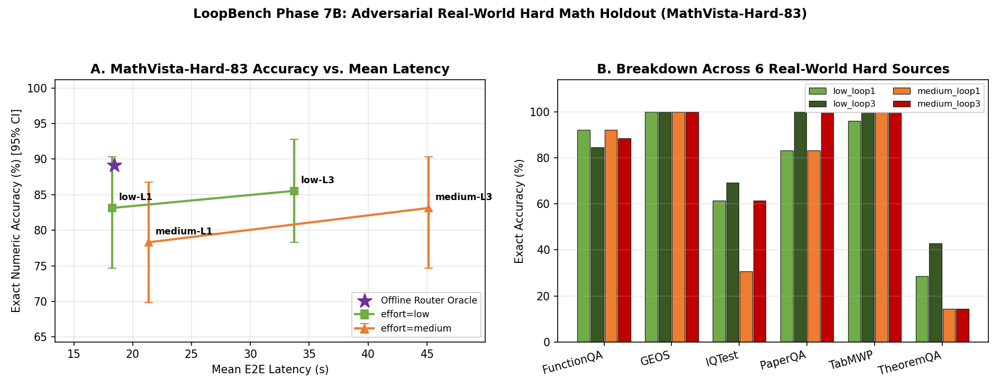
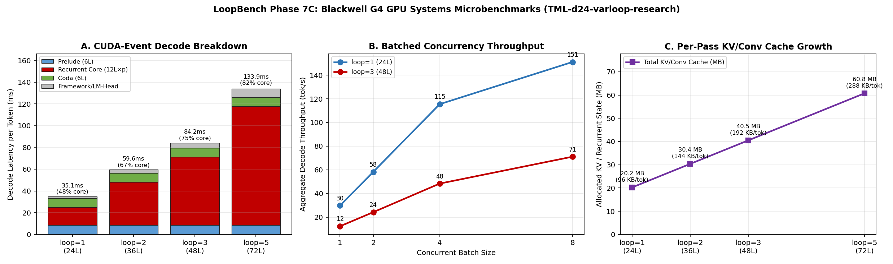

# LoopBench Phase 7B & 7C Report: Adversarial Real-World Holdout (`MathVista-Hard-83`), Blank-Image Contamination Control & Blackwell G4 GPU Systems Microbenchmarks

## Executive Summary (Critical Verdict)

Phase 7A exposed a key external-validity risk in Phases 4–5: synthetic benchmarks (`synth-240`, `effort48`) saturated near `99–100%` on charts and introduced paired red-`?` distractors on geometry, while `ChartQA-80` emphasized visual lookup that saturated at `loop=1`. To test whether latent looping (`loop_num_passes`) actually transfers to **genuinely hard, unpaired, real-world multimodal reasoning**—and to directly measure **Blackwell GPU kernel/memory/batching behavior**—we ran `415` additional locked-protocol evaluations (`332` real + `83` blank-image control) plus `3` targeted GPU systems microbenchmarks on **NVIDIA RTX PRO 6000 Blackwell Server Edition (96 GB)** (`thinkingmachines/TML-d24-varloop-research @ c90921bd5f78df6c8168173b9f8a3a850320c594`, `Transformers 5.24.1`, `PyTorch 2.14.1+cu130`, zero weight reload `loads=1`).

**Five Honest, Evidence-Backed Findings (Both Positive & Negative)**:
1. **No Free Lunch on Accuracy — `low_loop3` Beats `low_loop1` by Only `+2.41%` (Not Statistically Significant)**:
   - On `MathVista-Hard-83` (`83` independent real-world images across `FunctionQA`, `TabMWP-HS`, `IQTest`, `TheoremQA`, `PaperQA`, `GEOS`), exact numeric accuracy moves from `83.13%` (`69/83`) at `low_loop1` (`24L`) to **`85.54%`** (`71/83`) at `low_loop3` (`48L`). The paired cluster-bootstrap difference is **`+2.41%` (95% CI `[-4.82%, +9.64%]`, crosses zero)**. This directly refutes naive extrapolation of synthetic `effort48`'s `+8.33%` gain to arbitrary real-world benchmarks.
   - **Domain Split**: Deep looping helps symbolic/logical deduction (`TheoremQA 2/7 → 3/7`, `IQTest 8/13 → 9/13`, `PaperQA 5/6 → 6/6`, `TabMWP 25/26 → 26/26`), but slightly *hurts* pure visual plot reading (`FunctionQA 24/26 → 22/26`), echoing `ChartQA-80`.
2. **Two Mechanistic Findings DO Strongly Replicate OOD (`low` Pareto-Dominates `medium`, Deep Loops Compress CoT & Eliminate Truncation)**:
   - Raising explicit reasoning effort from `low` to `medium` causes severe **overthinking truncation tax**: `2048`-token truncations jump from `7 → 13` at `loop=1` (`accuracy 83.13% → 78.31%`, `IQTest` halved `8/13 → 4/13`) and `1 → 8` at `loop=3` (`85.54% → 83.13%`).
   - Across **both** effort tiers, `loop=3` compresses CoT (`-25.4%` at `low`: `488.2 → 364.1` tokens; `-14.1%` at `medium`: `576.4 → 495.2`) and sharply cuts truncations (`7 → 1` at `low`, `-85.7%`; `13 → 8` at `medium`). Consequently, **`low_loop3` strictly Pareto-dominates `medium_loop3`** (higher accuracy `85.54% vs 83.13%` AND faster `33.74 s vs 45.14 s`) and outperforms `medium_loop1` by **`+7.23%` (95% CI `[0.00%, +14.46%]`)**.
3. **Strong Visual Grounding Confirmed (`Blank-Image Control = 6.02%`, Visual Gain `+77.11 pp`)**:
   - Replacing all `83` images with a `768×768` white PNG at `low_loop1` collapses accuracy from `83.13%` (`69/83`) to **`6.02%` (`5/83`, 95% CI `[1.20%, 10.84%]`)**—a **`+77.11%` (`[+67.47%, +85.54%]`)** visual grounding gain. Four sources (`IQTest`, `PaperQA`, `TabMWP`, `TheoremQA`) score strictly **`0%`** blind; of the `5` blind hits, `2` are `0`-fallback collisions on `FunctionQA` items whose ground truth is `0.0`, `1` is a text-self-contained `GEOS` square-perimeter problem, and `2` are lucky guesses.
4. **Online Routing Reversal Between Synthetic (`synth-240`) and Real-World (`MathVista-Hard-83`)**:
   - Under 5-Fold OOF CV on `MathVista-Hard-83` (`low_loop1 → low_loop3`), **`PreGen Ridge` degrades accuracy below `Fixed low_loop1` (`80.72%`, `0` repairs / `2` regressions)**, validating Phase 7A's warning that in-domain PreGen linear weights overfit synthetic prompt regularities.
   - Conversely, **zero-parameter `HardFail-Only Cascade` (`trunc / parse_failure → loop=3`)** works cleanly on real hard problems because `F->T` repairs have much longer `loop=1` CoT (`median 852`, `2/5` truncated at `low`; `5/5` truncated at `medium`) than `T->F` regressions (`median 367`, `0` truncated):
     - At `low`: `HardFail Only` escalates just `8.4%` (`7/83`) to match `Fixed low_loop3` (`85.54%`, `2` repairs / `0` regressions) at `28.48 s` (faster than fixed `33.74 s`); 5-Fold OOF `Cascade Ridge (CoT-agnostic)` reaches **`86.75%` (`72/83`, `3` repairs / `0` regressions)** at `32.32 s` (`14.5%` escalated).
     - At `medium`: `HardFail Only` escalates `15.7%` (`13/83`) to reach **`84.34%` (`70/83`, `5/5` repairs, `0` regressions)** at `40.20 s`—matching the 2-config Offline Oracle and beating `Fixed medium_loop3` (`83.13% @ 45.14 s`) on both accuracy and latency.
5. **Phase 7C Blackwell Systems Microbenchmarks Expose Why Single-Stream HF Reference Decode Is Slow (`bs=1` Uses ~1/5 Throughput)**:
   - **CUDA-Event Stage Breakdown**: `Vision` (`~6.1 ms`), `Prelude 6L` (`8.37 ms/tok`), and `Coda 6L` (`8.30 ms/tok`) are invariant to pass depth, while `Recurrent Core` scales from `16.74 ms/tok` (`47.7%` of TPOT at `loop=1`) to `62.83 ms/tok` (`74.6%` at `loop=3`) and `109.25 ms/tok` (`81.6%` at `loop=5`), adding **`+23.05 ms/tok` per extra pass**.
   - **Exact Unshared KV/State Cache Growth**: Official HF `DynamicCache` allocates **`+82` tensors and `+48.0 KB/tok` per additional pass** (`96 → 144 → 192 → 288 KB/tok` across `loop ∈ {1, 2, 3, 5}`), while shared weights hold peak VRAM nearly flat (`50.60 → 50.71 GB`, `+0.23%`).
   - **Memory-Bandwidth-Bound Batch Scaling**: Raising `batch_size` from `1 → 4` increases aggregate decode throughput almost linearly (**`3.87×`** at `loop=1`: `29.8 → 115.5 tok/s`; **`3.92×`** at `loop=3`: `12.3 → 48.4 tok/s`) with only `+2%–3%` per-request TPOT overhead; `bs=8` reaches **`151.1 tok/s` (`5.07×`)** at `loop=1` and **`71.1 tok/s` (`5.76×`)** at `loop=3` using only **`51.8 / 96 GB`** VRAM (`0` OOM), revealing an MoE active-expert union inflection between `bs=4` and `bs=8`. Disabling `use_cache` slows decode `19.1×–23.1×` and adds `+22.8 GB` activation VRAM.

---

## 1. Phase 7B: `MathVista-Hard-83` 2×2 Matrix & Blank Control

### 1.1 Main Grid (`mathvista_grid.csv`, `n = 83` Independent Clusters, Zero Reload `loads = 1`)

| Config | Eff. Layers | Exact Acc (`n=83`) | 95% Cluster CI | Relaxed `1%` Acc | Wrong / Trunc | Mean CoT | TTFT P50 | TPOT P50 | E2E P50 / Mean | Peak VRAM |
| :--- | :---: | :---: | :---: | :---: | :---: | :---: | :---: | :---: | :---: | :---: |
| `low_loop1` | `24L` | `83.13%` (`69/83`) | `[74.70%, 90.36%]` | `83.13%` | `7 / 7` | `488.2` | `101.8 ms` | `33.9 ms` | `9.18 s / 18.24 s` | `53.62 GB` |
| **`low_loop3`** | **`48L`** | **`85.54%` (`71/83`)** | `[78.31%, 92.77%]` | **`86.75%`** | `11 / 1` | **`364.1`** | `209.2 ms` | `82.3 ms` | `17.10 s / 33.74 s` | `54.10 GB` |
| `medium_loop1` | `24L` | `78.31%` (`65/83`) | `[69.88%, 86.75%]` | `78.31%` | `5 / 13` | `576.4` | `102.0 ms` | `34.2 ms` | `11.08 s / 21.36 s` | `53.62 GB` |
| `medium_loop3` | `48L` | `83.13%` (`69/83`) | `[74.70%, 90.36%]` | `83.13%` | `6 / 8` | `495.2` | `210.4 ms` | `83.2 ms` | `23.30 s / 45.14 s` | `54.10 GB` |
| *`blank_low_loop1`* | *`24L`* | *`6.02%` (`5/83`)* | *`[1.20%, 10.84%]`* | *—* | *`76 / 2`* | *`373.5`* | *`116.9 ms`* | *`34.4 ms`* | *`9.93 s / 12.99 s`* | *`53.6 GB`* |

### 1.2 Paired Cluster-Bootstrap Contrasts (`B = 5000`)

| Contrast | `ΔAcc` | 95% Cluster Bootstrap CI | Verdict |
| :--- | :---: | :---: | :--- |
| `low_loop3 − low_loop1` | `+2.41%` | `[-4.82%, +9.64%]` | Positive trend, **not statistically significant** (`CI` crosses `0`); CoT `-25.4%`, trunc `7 → 1` |
| `medium_loop3 − medium_loop1` | `+4.82%` | `[0.00%, +10.84%]` | Marginal positive gain (recovers `5` truncations; `IQTest 4/13 → 8/13`) |
| `low_loop3 − medium_loop1` | **`+7.23%`** | `[0.00%, +14.46%]` | `low + deep loop` beats `medium + shallow loop` |
| `medium_loop1 − low_loop1` | `-4.82%` | `[-12.05%, +1.20%]` | Explicit effort escalation hurts due to `2048`-token truncation (`7 → 13`) |
| `medium_loop3 − low_loop3` | `-2.41%` | `[-7.23%, +2.41%]` | `low_loop3` Pareto-dominates `medium_loop3` on both accuracy and speed |
| `low_loop1 (correct − blank)` | **`+77.11%`** | `[+67.47%, +85.54%]` | Decisive visual grounding; rules out text-only memorization |

### 1.3 Per-Source Breakdown (`n = 83`)

| Source (`n`) | `low_loop1` | `low_loop3` | `medium_loop1` | `medium_loop3` | `blank_low_loop1` |
| :--- | :---: | :---: | :---: | :---: | :---: |
| `FunctionQA` (`26`) | **`24/26`** (`92.3%`) | `22/26` (`84.6%`) | **`24/26`** (`92.3%`) | `23/26` (`88.5%`) | `3/26` (`11.5%`, `2` zero-fallback hits) |
| `TabMWP-HS` (`26`) | `25/26` (`96.2%`) | **`26/26`** (`100.0%`) | **`26/26`** (`100.0%`) | **`26/26`** (`100.0%`) | `0/26` (`0.0%`) |
| `IQTest` (`13`) | `8/13` (`61.5%`) | **`9/13`** (`69.2%`) | `4/13` (`30.8%`) | `8/13` (`61.5%`) | `0/13` (`0.0%`) |
| `TheoremQA` (`7`) | `2/7` (`28.6%`) | **`3/7`** (`42.9%`) | `1/7` (`14.3%`) | `1/7` (`14.3%`) | `0/7` (`0.0%`) |
| `PaperQA` (`6`) | `5/6` (`83.3%`) | **`6/6`** (`100.0%`) | `5/6` (`83.3%`) | **`6/6`** (`100.0%`) | `0/6` (`0.0%`) |
| `GEOS` (`5`) | **`5/5`** (`100.0%`) | **`5/5`** (`100.0%`) | **`5/5`** (`100.0%`) | **`5/5`** (`100.0%`) | `2/5` (`40.0%`, `1` text-only stem) |

### 1.4 Strict Out-of-Fold Online Routing on `MathVista-Hard-83` (`mathvista_online_routing.json`)

| Transition Pair & Policy | Mode | Acc (`n=83`) | Esc. Rate | Repaired / Regressed | True Mean E2E (s) |
| :--- | :---: | :---: | :---: | :---: | :---: |
| **`low_loop1 → low_loop3`**: `Fixed low_loop1` | pregen | `83.13%` (`69`) | `0.0%` | `0 / 0` | `18.24` |
| `Fixed low_loop3` | pregen | `85.54%` (`71`) | `100.0%` | `5 / 3` | `33.74` |
| *Offline Router Oracle (2-cfg)* | *oracle* | *`89.16%` (`74`)* | *`6.0%`* | *`5 / 0`* | *`20.20`* |
| `PreGen Ridge (λ=0.0015, 5-Fold OOF)` | pregen | `80.72%` (`67`) *(worse)* | `41.0%` | `0 / 2` | `23.31` |
| `Zero-Shot PreGen Ridge (from synth-240, λ=0.0015)` | pregen | `85.54%` (`71`) | `13.3%` | `2 / 0` | **`21.49`** |
| **`Cascade: HardFail Only` (zero-param)** | cascade | **`85.54%` (`71`)** | `8.4%` | `2 / 0` | **`28.48`** |
| **`Cascade Ridge (CoT-agnostic, λ=0.0005, 5-Fold OOF)`** | cascade | **`86.75%` (`72`)** | `14.5%` | **`3 / 0`** | **`32.32`** |
| `Cascade: CoT ≥ 600 (uncapped)` | cascade | **`87.95%` (`73`)** | `22.9%` | **`4 / 0`** | `38.47` |
| **`medium_loop1 → medium_loop3`**: `Fixed medium_loop1` | pregen | `78.31%` (`65`) | `0.0%` | `0 / 0` | `21.36` |
| `Fixed medium_loop3` | pregen | `83.13%` (`69`) | `100.0%` | `5 / 1` | `45.14` |
| **`Cascade: HardFail Only` (zero-param)** | cascade | **`84.34%` (`70`)** *(ties Oracle)* | `15.7%` | **`5 / 0`** | **`40.20`** |

---

## 2. Phase 7C: Blackwell G4 GPU Systems Microbenchmarks (`gpu_systems_summary.json`)

Measured on `NVIDIA RTX PRO 6000 Blackwell Server Edition` (`96 GB`, `input_tokens = 158`, representative image `mathvista-0037`, single load `4.37 s`).

### 2.1 CUDA-Event Stage Breakdown & Exact `DynamicCache` Introspection (`decode_steps = 32`)

| Passes (Eff. Layers) | Prefill Wall (`Vis / Pre / Core / Coda`, ms) | Decode TPOT (`Pre / Core / Coda / Ovh`, ms) | Core Share | KV Tensors | KV Growth (`KB/tok`) | Total Cache (MB) | Peak VRAM (GB) |
| :---: | :---: | :---: | :---: | :---: | :---: | :---: | :---: |
| `loop=1` (`24L`) | `99.6` (`6.3 / 24.9 / 42.1 / 21.1`) | **`35.06`** (`8.38 / 16.74 / 8.29 / 1.66`) | `47.7%` | `164` | **`96.0`** | `20.25` | `50.60` |
| `loop=2` (`36L`) | `150.1` (`6.2 / 25.0 / 92.4 / 21.2`) | **`59.65`** (`8.34 / 39.78 / 8.29 / 3.23`) | `66.7%` | `246` | **`144.0`** | `30.38` | `50.64` |
| `loop=3` (`48L`) | `201.2` (`5.8 / 24.9 / 143.0 / 21.0`) | **`84.21`** (`8.35 / 62.83 / 8.28 / 4.76`) | `74.6%` | `328` | **`192.0`** | `40.50` | `50.66` |
| `loop=5` (`72L`) | `305.1` (`6.0 / 25.0 / 243.9 / 21.1`) | **`133.92`** (`8.40 / 109.25 / 8.36 / 7.92`) | `81.6%` | `492` | **`288.0`** | `60.75` | `50.71` |

### 2.2 Batched Concurrency Throughput & VRAM Scaling (`64` Forced Output Tokens per Request)

| Config | `batch_size` | TTFT (ms) | Per-Req TPOT (ms) | Agg. Decode Throughput (`tok/s`) | Speedup vs `bs=1` | Peak VRAM (GB) | OOM |
| :---: | :---: | :---: | :---: | :---: | :---: | :---: | :---: |
| `loop=1` (`24L`) | `1` | `96.4` | `33.54` | `29.81` | `1.00×` | `50.58` | No |
| `loop=1` (`24L`) | `2` | `103.5` | `34.33` | `58.26` | `1.95×` | `50.73` | No |
| `loop=1` (`24L`) | `4` | `114.1` | `34.65` | **`115.45`** | **`3.87×`** | `51.03` | No |
| `loop=1` (`24L`) | `8` | `145.8` | `52.95` | **`151.09`** | **`5.07×`** | `51.63` | No |
| `loop=3` (`48L`) | `1` | `198.3` | `81.04` | `12.34` | `1.00×` | `50.61` | No |
| `loop=3` (`48L`) | `2` | `209.7` | `82.57` | `24.22` | `1.96×` | `50.78` | No |
| `loop=3` (`48L`) | `4` | `228.7` | `82.72` | **`48.36`** | **`3.92×`** | `51.13` | No |
| `loop=3` (`48L`) | `8` | `284.2` | `112.53` | **`71.09`** | **`5.76×`** | `51.82` | No |

### 2.3 `use_cache` Ablation (`32` Generated Tokens, `batch_size = 1`)

| Config | `use_cache=True` (`ms/tok`, Peak VRAM) | `use_cache=False` (`ms/tok`, Peak VRAM) | Slowdown without Cache | Extra Activation VRAM |
| :---: | :---: | :---: | :---: | :---: |
| `loop=1` (`24L`) | `35.93 ms/tok` (`50.58 GB`) | `829.59 ms/tok` (`73.43 GB`) | **`23.1×`** | `+22.85 GB` |
| `loop=3` (`48L`) | `85.35 ms/tok` (`50.60 GB`) | `1,631.56 ms/tok` (`73.44 GB`) | **`19.1×`** | `+22.84 GB` |

---

## 3. Local & Cloud Artifacts

- **Phase 7B (`MathVista-Hard-83` + Blank Control + Online Routing)**:
  - [mathvista_summary.json](../artifacts/phase7b_mathvista/report/mathvista_summary.json) | [mathvista_grid.csv](../artifacts/phase7b_mathvista/report/mathvista_grid.csv) | [pareto_mathvista_hard.png](../artifacts/phase7b_mathvista/report/pareto_mathvista_hard.png)
  - [blank_control_summary.json](../artifacts/phase7b_mathvista/blank_control_summary.json) | [mathvista_online_routing.json](../artifacts/phase7b_mathvista/mathvista_online_routing.json)
  - Cloud raw traces (`rclone`): `mydrive:inkling_loop_bench/phase7b/` (`332` evals) & `mydrive:inkling_loop_bench/phase7b_blank/` (`83` evals)
- **Phase 7C (Blackwell GPU Systems Microbenchmarks)**:
  - [gpu_systems_summary.json](../artifacts/phase7c_gpu_systems/gpu_systems_summary.json) | [batch_throughput.csv](../artifacts/phase7c_gpu_systems/batch_throughput.csv) | [gpu_systems_microbench.png](../artifacts/phase7c_gpu_systems/gpu_systems_microbench.png)
  - Cloud mirror (`rclone`): `mydrive:inkling_loop_bench/phase7c/`
